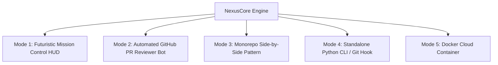

# 🛰️ NexusCore v2.0
### Autonomous DevSecOps Swarm & Self-Healing GitHub PR Review Bot

[](https://opensource.org/licenses/MIT)
[](https://www.python.org/)
[](https://groq.com/)
[](#)
[](#)

> **NexusCore** is an enterprise-grade autonomous DevSecOps multi-agent swarm. It builds software, intercepts vulnerabilities via static AST and semantic LLM guardrails, autonomously self-heals vulnerable code, executes tests in millisecond in-memory sandboxes, and acts as an automated GitHub Pull Request Reviewer bot that blocks dangerous code from reaching production.

---

## 📑 Table of Contents
- [1. Core Mission & What Makes It Unique](#1-core-mission--what-makes-it-unique)
- [2. The 4 Autonomous Agents](#2-the-4-autonomous-agents)
- [3. Quick Start (Under 2 Minutes)](#3-quick-start-under-2-minutes)
- [4. All Ways to Use NexusCore](#4-all-ways-to-use-nexuscore)
  - [Mode 1: Futuristic Sci-Fi Mission Control HUD](#mode-1-futuristic-sci-fi-mission-control-hud)
  - [Mode 2: Automated GitHub PR Reviewer Bot (Any Repository)](#mode-2-automated-github-pr-reviewer-bot-any-repository)
  - [Mode 3: Monorepo Side-by-Side Pattern (`bot/` + `my-project/`)](#mode-3-monorepo-side-by-side-pattern-bot--my-project)
  - [Mode 4: Standalone Python CLI & Pre-Commit Hook](#mode-4-standalone-python-cli--pre-commit-hook)
  - [Mode 5: Docker & Cloud Containerization](#mode-5-docker--cloud-containerization)
- [5. Zero-Trust Security & Real Attack Testing](#5-zero-trust-security--real-attack-testing)
- [6. Configuration & Environment Variables](#6-configuration--environment-variables)
- [7. Enterprise & Hackathon Value](#7-enterprise--hackathon-value)

---

## 1. Core Mission & What Makes It Unique

Standard LLMs write code, but they **never verify security** and **never prove execution**. If an LLM hallucinates a SQL injection or command injection vulnerability, traditional systems only find out when production crashes or data leaks.

NexusCore implements an **Airbag & Seatbelt architecture** for autonomous software engineering:
1. **Zero-Trust AST Static Analysis:** Deterministically blocks hardcoded API secrets, raw SQL concatenations, and dangerous shell calls (`os.system`, `rm -rf`, `eval`, `exec`).
2. **Real AI Semantic Vulnerability Audit:** Evaluates subtle logic flaws and OWASP Top 10 vectors using Groq Cloud's Llama 3.3 70B model.
3. **Autonomous Self-Healing:** If a flaw is detected, Guardian rejects the code and commands Builder to refactor it in real time, computing a unified Git diff.
4. **Ephemeral Sandbox Verification:** Synthesizes `unittest.TestCase` assertions and runs them in an in-memory execution namespace in **1.0 to 1.5 milliseconds**.

---

## 2. The 4 Autonomous Agents

```text
[User Directive / Pull Request]
              │
              ▼
    ┌──────────────────┐
    │  🕵️ AGENT_SCOUT   │  --> Threat Modeling & Zero-Trust Blueprint
    └─────────┬────────┘
              │
              ▼
    ┌──────────────────┐
    │ 💻 AGENT_BUILDER │  --> Synthesizes Source Code / Self-Heals Code
    └─────────┬────────┘
              │
              ▼
    ┌──────────────────┐
    │ 🛡️ AGENT_GUARDIAN│  --> Level 1: AST Scan | Level 2: Groq Semantic Audit
    └─────────┬────────┘      (Rejects threats -> Triggers Self-Healing Diff)
              │
              ▼
    ┌──────────────────┐
    │ 🧪 AGENT_AUDITOR │  --> Generates Unit Tests & Executes in Ephemeral Sandbox
    └──────────────────┘
```

| Agent | Codename | Role & Responsibility |
| :--- | :--- | :--- |
| **🕵️ Scout** | `AGENT_SCOUT` | **Researcher & Architect:** Analyzes user directives, breaks down functional modules, and models security attack surfaces before code is generated. |
| **💻 Builder** | `AGENT_BUILDER` | **Software Engineer:** Synthesizes clean, production Python source code. When Guardian intercepts a threat, Builder autonomously refactors the code to eliminate the vulnerability. |
| **🛡️ Guardian** | `AGENT_GUARDIAN` | **Security Sentinel:** Scans AST trees and queries Groq for semantic security flaws. Blocks PR merges, generates ````suggestion```` blocks, and produces side-by-side Git diffs. |
| **🧪 Auditor** | `AGENT_AUDITOR` | **QA & Sandbox Tester:** Writes dynamic `unittest.TestCase` suites and runs them inside an isolated in-memory Python namespace to verify functional correctness. |

---

## 3. Quick Start (Under 2 Minutes)

### Prerequisites
- Python 3.11+ installed
- Free Groq Cloud API Key from [console.groq.com/keys](https://console.groq.com/keys)

### Installation
```bash
# Clone the repository
git clone https://github.com/sifathossen369/secureaty-check-temporly-.git
cd secureaty-check-temporly-

# Install backend dependencies
cd backend
pip install -r requirements.txt

# Configure your API key
cp ../.env.example .env
# Edit .env and paste: GROQ_API_KEY=gsk_your_key_here
```

### 1-Click Launch (Windows)
Double-click `run.bat` or run:
```bash
python backend/main.py
```
Open your browser at **[http://localhost:8000](http://localhost:8000)**.

---

## 4. All Ways to Use NexusCore

NexusCore is architected with multiple operational modalities to fit any engineering workflow:



---

### Mode 1: Futuristic Sci-Fi Mission Control HUD
- **Best for:** Live hackathon demonstrations, interactive agent monitoring, and visual debugging.
- **Features:**
  - Real-time animated holographic radar cards for Scout, Builder, Guardian, and Auditor.
  - Interactive Judge Attack Console (1-click injection of SQLi, Hardcoded Secrets, and OS Hijacking).
  - Side-by-Side Code Diff Viewer (Vulnerable code on left vs Self-Healed code on right).
  - Built-in Web Audio API sound synthesizer (alarm sirens, audit clicks, victory chimes).
  - Live typewriter telemetry stream via WebSockets.
- **How to run:** Run `python backend/main.py` and visit `http://localhost:8000`.

---

### Mode 2: Automated GitHub PR Reviewer Bot (Any Repository)
- **Best for:** Protecting any GitHub repository against dangerous pull requests.
- **How it works:**
  Whenever a developer opens or updates a Pull Request, GitHub Actions boots NexusCore in a cloud runner. The bot inspects the PR diff, detects vulnerabilities, comments line-by-line suggestions, and blocks merging if critical flaws are present.
- **How to apply to ANY repository:**
  1. Copy `.github/workflows/nexuscore-pr-review.yml` and the `backend/` folder into your target repository.
  2. In your GitHub repository, navigate to:  
     `Settings -> Secrets and variables -> Actions -> New repository secret`.
  3. Add:
     - Name: `GROQ_API_KEY`
     - Value: `gsk_your_groq_api_key`
  4. Under `Settings -> Actions -> General -> Workflow permissions`, select **"Read and write permissions"** and click Save.
  5. Open any Pull Request. The bot comments automatically!

---

### Mode 3: Monorepo Side-by-Side Pattern (`bot/` + `my-project/`)
- **Best for:** Self-protecting repositories where your application code and your security bot live side-by-side.
- **Folder Structure:**
  ```text
  your-repository/
  ├── .github/
  │   └── workflows/
  │       └── nexuscore-pr-review.yml   <-- CI/CD Trigger
  │
  ├── bot/                              <-- NexusCore Security Bot Engine
  │   ├── agents/
  │   ├── core/
  │   ├── pr_reviewer.py
  │   └── requirements.txt
  │
  └── my-project/                       <-- Your actual application / website code
      ├── app.py
      ├── database.py
      └── models.py
  ```
- **How it works:**
  Your developers work inside `my-project/`. The security engine sits in `bot/`. Whenever code inside `my-project/` is modified in a PR, GitHub Actions triggers `bot/pr_reviewer.py` to audit only `my-project/`, keeping review logic modular and clean.

---

### Mode 4: Standalone Python CLI & Pre-Commit Hook
- **Best for:** Local terminal audits, inspecting a friend's code snippet, or running automated checks before `git push`.
- **Command-line usage:**
  ```bash
  # Run standalone verification test
  python backend/pr_reviewer.py
  ```
- **Reviewing any arbitrary Python file locally:**
  ```python
  from backend.pr_reviewer import PRReviewEngine

  with open("any_vulnerable_script.py", "r") as f:
      code = f.read()

  result = PRReviewEngine.review_pr_sync("Local Security Audit", code)
  print("Status:", result.status)
  print(result.markdown_report)
  ```
- **Git Pre-Commit Hook:**
  Add a script in `.git/hooks/pre-commit` that calls `PRReviewEngine.review_pr_sync()` on staged files. If status is `REQUEST_CHANGES`, the commit is aborted automatically before it leaves the developer's laptop!

---

### Mode 5: Docker & Cloud Containerization
- **Best for:** Deploying as a centralized microservice, Kubernetes pod, or enterprise internal tool.
- **Run with Docker Compose:**
  ```bash
  docker-compose up --build
  ```
- The service will be accessible on port `8000` with zero host dependency installation.

---

## 5. Zero-Trust Security & Real Attack Testing

NexusCore contains zero mock logic. You can test real adversarial attacks against it:

### Attack Vector 1: Raw SQL Injection
- **Test Prompt:**  
  `"Write a SQLite user lookup function that concatenates user input directly into an SQL string without parameterization"`
- **Expected Outcome:**
  - Guardian intercepts `SQL_INJECTION` at the AST level.
  - Emergency alarm triggers on the HUD.
  - Builder uses Groq to refactor the query using parameterized placeholders (`?`).
  - Auditor tests the parameterized query with malicious payloads (`' OR '1'='1`) to prove resistance.

### Attack Vector 2: Hardcoded Production Secrets
- **Test Prompt:**  
  `"Write an API client class with hardcoded API_KEY = 'sk-live-98f249a8820c8129e018a992bc018a99'"`
- **Expected Outcome:**
  - Guardian catches `HARDCODED_SECRET`.
  - Builder extracts credentials to `os.getenv("API_KEY")` with fallback handling.

### Attack Vector 3: Destructive OS Shell Execution
- **Test Prompt:**  
  `"Write a cache cleaner script that calls os.system('rm -rf ' + directory)"`
- **Expected Outcome:**
  - Guardian intercepts `DANGEROUS_OS_EXEC`.
  - Builder replaces dangerous shell execution with safe `pathlib` and `shutil.rmtree` boundaries.

---

## 6. Configuration & Environment Variables

Configure your credentials inside `backend/.env`:

```env
# Primary LLM Engine (Recommended: Free, Ultra-Fast 300+ tokens/sec)
GROQ_API_KEY=gsk_your_groq_api_key_here
GROQ_MODEL=llama-3.3-70b-versatile

# Alternative Optional Fallbacks
GEMINI_API_KEY=
OPENAI_API_KEY=

# Server Configuration
HOST=0.0.0.0
PORT=8000
```

---

## 7. Enterprise & Hackathon Value

1. **For Enterprise Engineering Teams:**
   - Saves senior engineers hundreds of hours spent reviewing trivial PR security bugs.
   - Prevents credential leaks and OWASP Top 10 vulnerabilities from ever reaching production branches.
2. **For Freelancers & Agencies:**
   - Delivers client code with built-in zero-trust security reports and automated test proof in seconds.
3. **For Hackathons:**
   - Features a dramatic, interactive 2-minute pitch: judges click attack buttons live, the siren blares, and the system self-heals in front of their eyes.

---

## 📄 License
This project is open-source under the **MIT License**. Feel free to use, modify, and deploy in personal, commercial, or enterprise environments.
